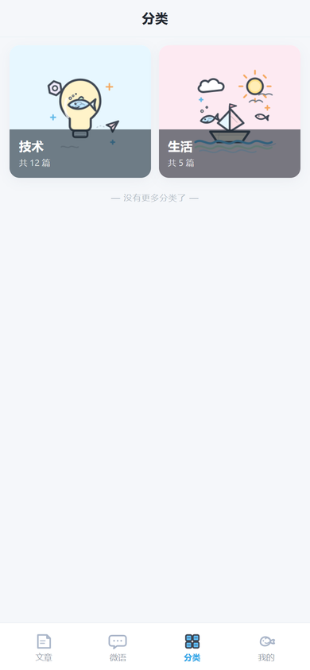
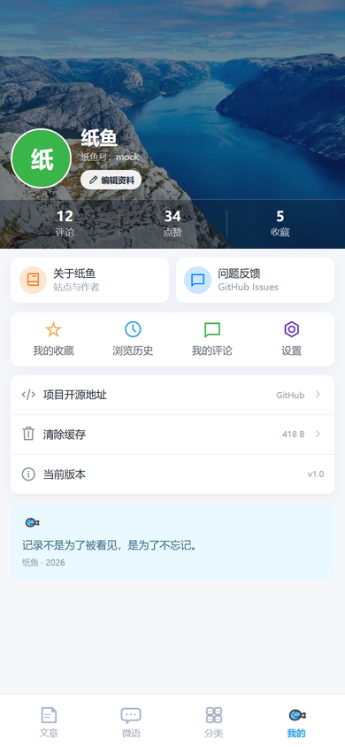
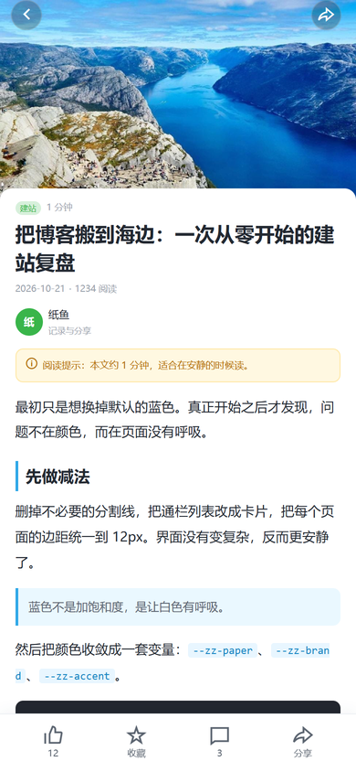

# pafish-mp

纸鱼博客（pafish）的开源微信小程序前端：**uni-app + Vue3 + vite**，自绘界面，TDesign 仅用于底层图标与弹层；配套服务端插件 [`wechat_mp`](https://github.com/shuyu0131/pafish-php) 提供 `/mp/*` 接口。

> 本仓库不包含任何服务端密钥。小程序只持有接口地址与用户自己的登录 token；微信 `AppSecret`、pafish `/api/v1` 的 `X-API-Key` 全部留在插件服务端。

## 界面

- **首页**：全幅天空插画 + 压在插画下缘的玻璃搜索条 + 白色公告卡 + 最多 4 个分类宫格 + 文章卡
- **分类**：两列大卡片，分类封面优先，无封面用品牌分类插画
- **搜索**：首页搜索条直接输入，确认后原地切换为结果态，不跳转独立页面
- **微语**：按天分组的白卡时间流，标题居中
- **我的**：照片头图 + 头部数据带 + 服务卡 + 四宫格 + 列表
- **详情**：全幅封面 + 白色正文 + 黄色阅读提示 + 固定操作栏 + 返回顶部

底栏为自绘 4 Tab PNG 图标：文章 / 微语 / 分类 / 我的。手绘插画放在 `src/static/illus/`；文章卡圆角 10px，图片 8px。

## 界面预览

> 截图来自 H5 构建 + 本地 mock 数据，用于展示布局与视觉；真实小程序以接口数据为准。

<table>
  <tr>
    <td align="center"><br/><sub>首页</sub></td>
    <td align="center"><br/><sub>分类</sub></td>
    <td align="center"><br/><sub>搜索结果</sub></td>
  </tr>
  <tr>
    <td align="center"><br/><sub>微语</sub></td>
    <td align="center"><br/><sub>我的</sub></td>
    <td align="center"><br/><sub>文章详情</sub></td>
  </tr>
</table>

## 功能

| 页面 | 说明 |
| --- | --- |
| 首页 | 天空插画、玻璃搜索、公告卡、分类宫格、文章流、置顶标记、分页 |
| 分类 | 两列分类大卡，封面优先，点击回首页筛选 |
| 搜索 | 首页输入、原地结果、搜索历史与空态（可在插件侧关闭） |
| 文章详情 | 正文 rich-text 渲染、浏览量、点赞 / 收藏、评论、返回顶部 |
| 微语 | 按天分组的时间流卡片、图片预览、点赞与修改标记、单条分享 |
| 我的 | 微信头像昵称授权、评论 / 收藏 / 历史、照片头图数据带 |
| 设置 / 关于 | 账号入口、清除缓存、站点与版本信息、退出登录 |

## 审核合规设计

个人小程序类目对评论、点赞、第三方登录等互动功能有审核限制，本项目按"**功能可以存在，也可以随时关掉过审**"实现：

- 插件端有一个 `audit_mode` 总开关。开启后 `/mp/config` 返回 `features.login / comment / like / favorite = false`，同时 **服务端对相应 POST 接口直接 403**——前端隐藏 + 服务端拦截双保险，抓包也绕不过。
- 微语浏览、文章浏览、搜索不受总开关影响，保证审核期间小程序仍有完整可读内容。
- 前端所有互动入口按 `feat()` / `auditMode()` 逐页门控；分享卡片在审核模式下退化为通用首页卡片。

## 快速开始

```bash
npm install
```

1. 修改 `src/common/config.js` 中的 `BASE_URL` 为你的站点地址（需 https 且在小程序后台配置 request 合法域名；本地联调用 `http://127.0.0.1:8123` 并勾选"不校验合法域名"）。
2. 编译：

```bash
npm run build:mp-weixin   # 产物在 dist/build/mp-weixin
```

3. 微信开发者工具导入 `dist/build/mp-weixin`，填入自己的小程序 AppID。

## 配套插件

服务端需要在 pafish 后台启用 `wechat_mp` 插件，并在插件设置页填写：

- 小程序 `AppID` / `AppSecret`（仅存服务端，用于 `/mp/login` 换取 openid）
- 功能开关：审核模式、登录、评论、点赞、收藏、微语、搜索、每页条数

插件启用后 `/mp/*` 接口自动注册，无需其他配置。接口约定：

- 读接口（`GET /mp/config`、`/mp/posts`、`/mp/micro` …）游客可直接访问；
- 互动接口需 `X-MP-Token` 请求头（`/mp/login` 返回的 token）+ 表单 `_csrf`（`/mp/config` 返回，会话级校验）。

## 技术栈

- uni-app 3.x / Vue 3 / vite / `@tdesign/uniapp`（easycom `t-*`）
- 状态与网络层自写在 `src/common/`（config / request / store / format / theme / history / mdcss）
- 业务组件 easycom `zz-*`（导航、底栏、文章卡、搜索条、空态、骨架、操作栏、微语卡、评论、头像、登录弹层），无原生 tabBar，底栏用自绘 PNG 图标 + `uni.reLaunch` 切换

## 许可

MIT
